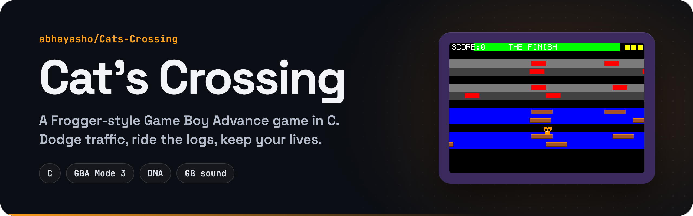
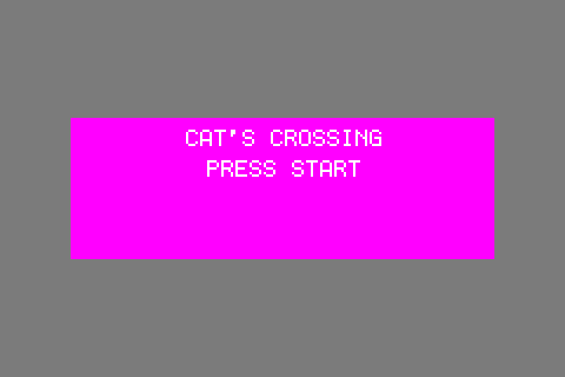
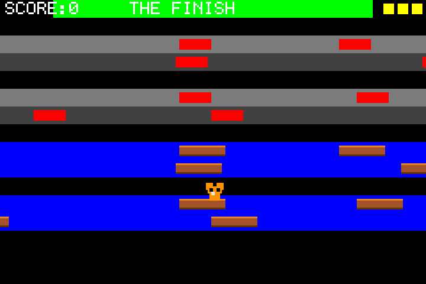
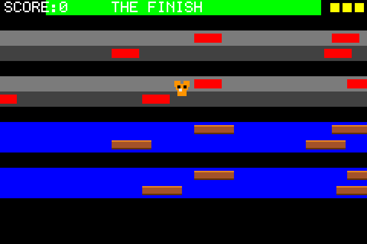
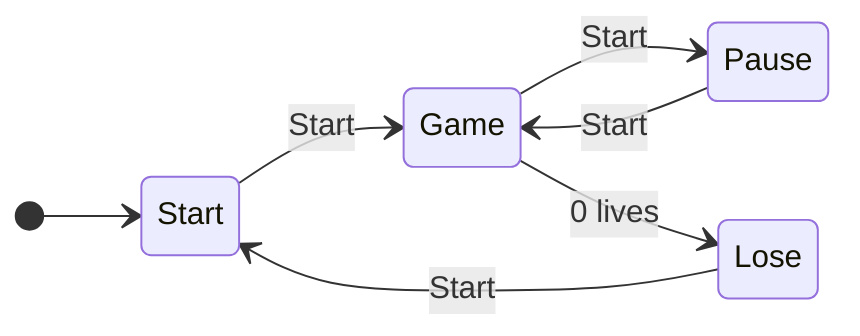

  

  
  
  

**Cat's Crossing** is a Frogger-inspired Game Boy Advance game written in C. Guide the cat from the bottom of the screen to the green finish line: dodge the cars on the roads and hop across the river on the logs. Every crossing scores points and brings a new, randomized level, and it keeps going until you run out of lives.

<table>
  <tr>
    <td align="center"> Title screen</td>
    <td align="center"> Riding the logs</td>
    <td align="center"> Dodging traffic</td>
  </tr>
</table>

Frames drawn by the game's own C code at the GBA's 240×160 resolution, scaled up 3×.

## How to play

- **Goal:** get the cat from the start area at the bottom to the green **finish** zone at the top.
- **Roads (gray):** cars slide in from the sides. One hit costs a life.
- **Rivers (blue):** the water is deadly, so ride the logs across.
- **Lives:** you start with 3, shown as yellow squares in the corner. Losing one sends you back to the start of the same level; your score stays.
- **Scoring:** each crossing is worth **100 points** and moves you to a new level with a different layout of cars and logs.

### You lose a life when you…

- touch a car;
- land in the water instead of on a log;
- ride a log off the left or right edge of the screen.

## Controls

| Button | Action |
| --- | --- |
| **D-Pad Up / Down** | Move one lane up or down |
| **D-Pad Left / Right** | Step left or right |
| **Start** | Start the game · pause / resume · return to the title from Game Over |

Movement is grid-based, one step per press. A, B and the shoulder buttons aren't used.

## Game flow

There's also a **Win** screen in the code that returns to the title, but levels repeat endlessly, so in practice a run ends at **Game Over**. The Game Over screen shows how many levels you cleared and your final score.

## Under the hood

- **Mode 3 bitmap graphics.** Everything is drawn straight into the 240×160, 15-bit-color framebuffer.
- **DMA fills.** Rectangles (lanes, cars, logs, the cat) are drawn one row at a time with DMA channel 3, using a fixed source and an incrementing destination.
- **Dirty-rectangle redraws.** Only the areas that moved are erased and redrawn each frame, so the full background is rarely repainted.
- **State machine.** Start → Game ⇄ Pause → Lose, driven by `BUTTON_PRESSED` edge detection on the key register.
- **Seeded RNG.** A small deterministic random number generator places the cars and logs on each new level.
- **Analog sound.** Sound effects use the GBA's Game Boy-compatible tone channels.
- **Custom font.** A 6×8 bitmap font renders the score, the HUD and the menu text.

## Known issues

- Levels are randomized, so cars and logs can bunch up and some runs feel harder than others.
- Two log rows can occasionally move in the same direction at the same speed, which can make a crossing impossible.
- Stepping from a log into the water sometimes doesn't cost a life.

## Building

This was built for a CS course with the course's GBA toolchain: run the provided build task (a Docker-based GBA compiler) to produce a `.gba` ROM, then open it in an emulator such as [mGBA](https://mgba.io).

## Project files

| File | What's inside |
| --- | --- |
| `main.c` | Game loop and state machine (start, game, pause, win, lose) |
| `game.c` / `game.h` | Lanes, cars, logs, the cat, collisions, scoring and levels |
| `gba.c` / `gba.h` | Registers, Mode 3 drawing helpers, DMA and input |
| `font.c` / `font.h` | 6×8 bitmap font |
| `analogSound.c` / `analogSound.h` | Tone channels for the sound effects |
| `print.c` / `print.h` | mGBA debug logging |
